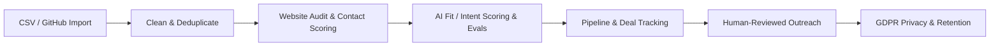

# Lead Intelligence Platform

A full-stack B2B prospect research, enrichment, and qualification platform built with **Next.js 16**, **TypeScript**, **Supabase PostgreSQL**, and **AI scoring guardrails**.

Turns raw company lists into clean, enriched, and qualified sales opportunities — with live AI accuracy checks, safe deal workflows, human-reviewed outreach, and built-in GDPR privacy controls.

---

## How It Works



1. **Import & Validate** — Maps messy CSV uploads or GitHub batches with Zod, quarantining broken rows without failing clean records.
2. **Clean & Deduplicate** — Normalizes URLs and company suffixes, then runs 3-tier matching (exact domain + fuzzy name/location match) to prevent duplicates.
3. **Enrich & Audit** — Crawls public website signals within serverless time budgets, detects conversion gaps, and ranks decision-maker contacts.
4. **Score & Evaluate** — Combines fit and intent scoring with a live ground-truth evaluation harness (precision, recall, F1, contact accuracy, and locked regression checks).
5. **Track & Comply** — Moves deals through validated stage rules, checks every AI outreach claim against real enrichment data before human review, and enforces GDPR Art. 15/17 & 180-day retention rules.

---

## Engineering Highlights

| Area | Source | What It Does |
| :--- | :--- | :--- |
| **AI Evals & Regression** | [`src/lib/evaluation/regression-suite.ts`](src/lib/evaluation/regression-suite.ts) | Measures live precision, recall, F1, and contact selection against labeled test cases and locked invariants. |
| **3-Tier Deduplication** | [`src/lib/dedupe.ts`](src/lib/dedupe.ts) | Canonicalizes domains and applies Levenshtein name/location matching to block duplicate accounts. |
| **State Machines & Concurrency** | [`src/lib/crm/opportunity-state-machine.ts`](src/lib/crm/opportunity-state-machine.ts) | Enforces valid deal and outreach stage transitions with compare-and-swap SQL updates. |
| **Claim Checks & Quality Gate** | [`src/lib/outreach/quality-gate.ts`](src/lib/outreach/quality-gate.ts) | Traces every outreach claim back to verified enrichment signals so unverified drafts get flagged before approval. |
| **GDPR Export & Erasure** | [`src/lib/compliance/gdpr.ts`](src/lib/compliance/gdpr.ts) | Supports Art. 15 JSON exports, Art. 17 PII erasure, and one-way SHA-256 suppression hashing. |
| **Anti-Replay Webhooks** | [`src/lib/webhook-verification.ts`](src/lib/webhook-verification.ts) | Verifies Svix HMAC-SHA256 webhook signatures with a strict 5-minute replay window. |
| **Auth & 16-Table RLS** | [`supabase/migrations/20261016_enable_rls.sql`](supabase/migrations/20261016_enable_rls.sql) | Combines Next.js 16 `proxy.ts`, per-action `requireUser()`, and Postgres RLS revoking `anon` access across all 16 tables. |
| **Batch Limits & Safe CSVs** | [`src/lib/acquisition.ts`](src/lib/acquisition.ts) · [`src/lib/crm/csv.ts`](src/lib/crm/csv.ts) | Checkpoints ingestion inside 50-second serverless budgets and neutralizes spreadsheet formula injection on export. |

---

## Key Design Decisions

- **GDPR Erasure Without Re-Contacting:** Deleting an email under Article 17 normally risks accidentally re-importing that person later. Erased emails are stored as one-way SHA-256 hashes in `suppressions`, blocking future contact without storing personal data.
- **No Unsupervised Cold Emailing:** Outreach defaults to sandbox delivery (`delivered@resend.dev`) and requires human approval, claim verification, a recorded lawful basis, and signed 1-click unsubscribe links.
- **Real Data Over Vanity Numbers:** Empty denominators render `—` instead of misleading zeroes, unavailable website checks are marked explicitly rather than guessed, and evaluation metrics clearly separate labeled accounts from calibration cases.

---

## Tech Stack

- **Framework:** Next.js 16 (App Router, Turbopack, Server Actions, `proxy.ts`)
- **Language & Validation:** TypeScript 5, Zod 4
- **Database & Auth:** Supabase PostgreSQL (16 tables, Row-Level Security) + Supabase Auth
- **AI & Messaging:** Gemini (OpenAI-compatible SDK), Resend, Svix HMAC webhook verification
- **Styling:** CSS Modules with light/dark editorial tokens (`Instrument Serif`, `Plus Jakarta Sans`, `Geist Mono`)
- **Testing & CI:** Node.js native test runner (`node:test`, 32 automated tests) + GitHub Actions

---

## Live Demo & Deployment Modes

Anyone can explore the live app without creating an account:
- Click **Live Demo →** on `/` (or visit `/demo`) to open `/crm/dashboard` in read-only preview mode.
- Browse live dashboard metrics and AI evals (`/crm/dashboard`), scored prospects and CSV exports (`/crm/prospects`), the deal pipeline (`/crm/pipeline`), outreach drafts and flagged claim checks (`/crm/outreach`), and GDPR Art. 15 JSON exports (`/crm/compliance`).
- Write actions stay safely locked in demo mode so sample data stays clean.

**Public Demo vs. Private Workspace:**
- **Public portfolio demo:** Leave `DISABLE_DEMO_MODE=false` with a dedicated Supabase project populated only by `npm run seed`.
- **Private production use:** Set `DISABLE_DEMO_MODE=true` with a separate private Supabase project and sign in at `/login` using an approved account (`profiles.approved = true`).

---

## Quickstart

### 1. Install Dependencies
```bash
npm install
```

### 2. Configure Environment Variables
```bash
cp .env.example .env.local
```

### 3. Apply Migrations & Seed Sample Dataset
Run the SQL migrations in [`supabase/migrations/`](supabase/migrations/) inside your Supabase SQL editor, then seed the 10-company B2B dataset:
```bash
npm run seed
```

### 4. Run Locally
```bash
npm run dev
```
Open [http://localhost:3000](http://localhost:3000).

---

## Scripts

```bash
npm test            # Run 32 automated unit, security, and eval tests (12 suites)
npm run typecheck   # TypeScript type checking
npm run build       # Production Next.js build
npm run seed        # Seed sample B2B companies, scores, deals, and outreach drafts
```

---

## License

MIT
